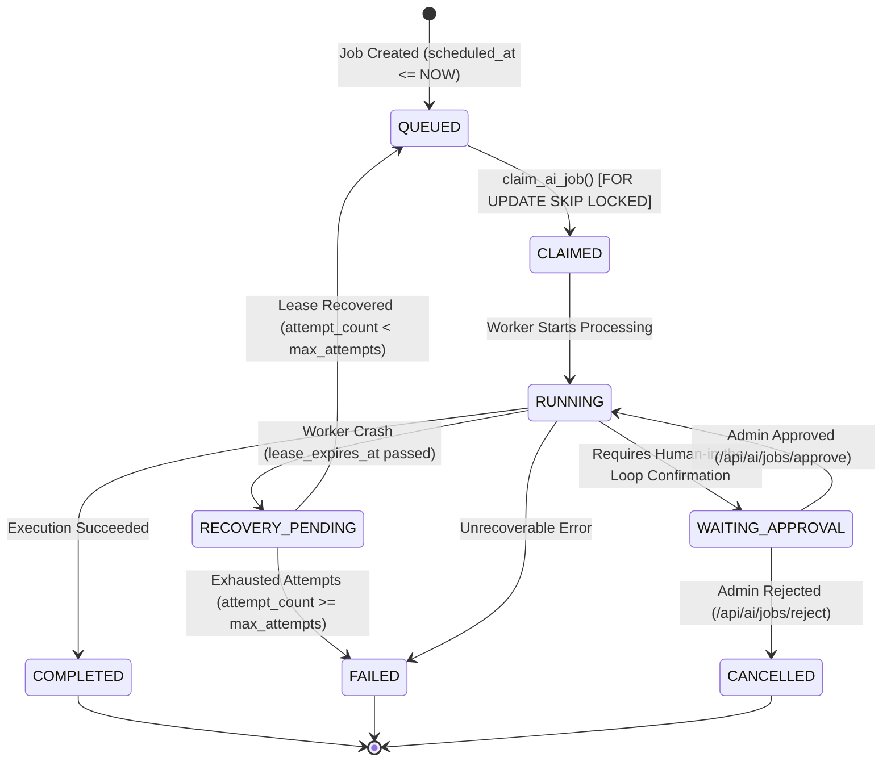

# SYNCORA Platform Major Release 18 — Phase 3
# Background Job Execution & Durable Queue Runtime

**Document Version:** 1.0.0  
**Status:** Audited & Verified  
**Scope:** Durable Asynchronous Queues, `ai_jobs` Runtime, Concurrency Locks, Lease Recovery

---

## 1. Background Processing Paradigms

SYNCORA utilizes a two-tier background processing architecture designed for operational predictability and durability without introducing external broker dependencies (such as Redis, Celery, or RabbitMQ):

1. **Lightweight Observer Queue (In-Memory Deferred via Next.js `after()`):**
   - Employed for instantaneous observer notifications, webhook dispatches, and in-band workspace automations.
   - Handled directly within the Node.js runtime process after the HTTP response has been committed.
   - Idempotency and audit trails are persisted synchronously to the database before asynchronous dispatch occurs.

2. **Durable Database Job Queue (`ai_jobs` PostgreSQL Runtime):**
   - Employed for long-running, CPU-intensive, or multi-step asynchronous AI workloads, background audits, and proactive task triage.
   - Persisted authoritatively in PostgreSQL with ACID guarantees, multi-worker safety, priority scheduling, and automated dead-worker lease recovery.

---

## 2. Durable Job Queue Schema & State Machine

The durable queue runtime is governed by migration [`00061_ai_durable_runtime.sql`](file:///c:/Users/Ibrahim/Desktop/SYNCORA-frontend-project/supabase/migrations/00061_ai_durable_runtime.sql) and modeled in [`src/types/ai-jobs.ts`](file:///c:/Users/Ibrahim/Desktop/SYNCORA-frontend-project/src/types/ai-jobs.ts).

### 2.1 State Transition Diagram



### 2.2 Table Definition Highlights
```sql
CREATE TABLE public.ai_jobs (
    id UUID PRIMARY KEY DEFAULT gen_random_uuid(),
    workspace_id UUID NOT NULL REFERENCES public.workspaces(id) ON DELETE CASCADE,
    user_id UUID NOT NULL REFERENCES auth.users(id) ON DELETE CASCADE,
    workflow_id TEXT REFERENCES public.ai_workflows(id) ON DELETE SET NULL,
    job_type TEXT NOT NULL CHECK (job_type IN ('EVENT_TRIGGERED', 'SCHEDULED', 'PROACTIVE')),
    trigger_type TEXT NOT NULL,
    payload JSONB,
    status TEXT NOT NULL DEFAULT 'QUEUED',
    priority INTEGER NOT NULL DEFAULT 0,
    executor_id TEXT,
    attempt_count INTEGER NOT NULL DEFAULT 0,
    max_attempts INTEGER NOT NULL DEFAULT 3,
    scheduled_at TIMESTAMPTZ DEFAULT NOW(),
    claimed_at TIMESTAMPTZ,
    started_at TIMESTAMPTZ,
    completed_at TIMESTAMPTZ,
    failed_at TIMESTAMPTZ,
    lease_expires_at TIMESTAMPTZ,
    next_attempt_at TIMESTAMPTZ,
    created_at TIMESTAMPTZ DEFAULT NOW(),
    updated_at TIMESTAMPTZ DEFAULT NOW()
);
```

---

## 3. High-Concurrency Job Claiming: `FOR UPDATE SKIP LOCKED`

To prevent double-execution when multiple serverless or containerized worker instances poll the queue simultaneously, jobs are claimed atomically using a PostgreSQL stored procedure with row-level locking:

```sql
CREATE OR REPLACE FUNCTION claim_ai_job(p_executor_id TEXT, p_limit INTEGER DEFAULT 1)
RETURNS SETOF public.ai_jobs 
LANGUAGE plpgsql 
SECURITY DEFINER
SET search_path = public, pg_temp
AS $$
BEGIN
  RETURN QUERY
  UPDATE public.ai_jobs
  SET 
    status = 'CLAIMED',
    executor_id = p_executor_id,
    claimed_at = NOW(),
    lease_expires_at = NOW() + INTERVAL '5 minutes'
  WHERE id IN (
    SELECT id 
    FROM public.ai_jobs 
    WHERE status = 'QUEUED' 
      AND (scheduled_at IS NULL OR scheduled_at <= NOW())
    ORDER BY priority DESC, created_at ASC
    FOR UPDATE SKIP LOCKED
    LIMIT p_limit
  )
  RETURNING *;
END;
$$;
```

### Concurrency Guarantees:
1. **Lock Elimination (`SKIP LOCKED`):** Worker A and Worker B querying at the identical millisecond never block each other. Worker B skips locked candidate rows and instantly claims the next available job.
2. **Priority Ordering:** Higher-priority jobs (`priority DESC`) take precedence, followed by FIFO order (`created_at ASC`).
3. **Lease Timeout:** Each claim reserves the job for exactly 5 minutes (`NOW() + INTERVAL '5 minutes'`).

---

## 4. Crash Recovery & Lease Expiration

If an executor experiences an out-of-memory error, network cutoff, or deployment kill during execution, the job does not remain permanently stranded.

### Recovery Algorithm:
1. **Detection:** Queries search for rows where `status IN ('CLAIMED', 'RUNNING')` and `lease_expires_at < NOW()`.
   - Optimized by index: `CREATE INDEX idx_ai_jobs_recovery ON public.ai_jobs(status, lease_expires_at) WHERE status IN ('CLAIMED', 'RUNNING');`
2. **Retry Evaluation:**
   - If `attempt_count < max_attempts`:
     - Increments `attempt_count = attempt_count + 1`.
     - Resets `status = 'QUEUED'`.
     - Calculates backoff for next attempt: `scheduled_at = NOW() + INTERVAL '1 minute'`.
     - Clears `executor_id = NULL`.
   - If `attempt_count >= max_attempts`:
     - Sets `status = 'FAILED'`.
     - Sets `failed_at = NOW()`.
     - Emits structured error log `ai_jobs.lease_exhausted`.

---

## 5. Security & RBAC Scoping

Job inspection and administrative interventions are strictly tenant-isolated:
- **Tenant Isolation:** Enforced via RLS in migration `00061`:
  ```sql
  CREATE POLICY "Users can view AI jobs in their workspace"
  ON public.ai_jobs FOR SELECT TO authenticated
  USING (workspace_id IN (SELECT workspace_id FROM public.workspace_members WHERE user_id = auth.uid()));
  ```
- **Administrative Control:** The dashboard API route [`/api/ai/jobs/route.ts`](file:///c:/Users/Ibrahim/Desktop/SYNCORA-frontend-project/src/app/api/ai/jobs/route.ts) mandates workspace admin verification via `checkWorkspaceAdmin(supabase, workspaceId)` before exposing queue telemetry or allowing state modifications.

